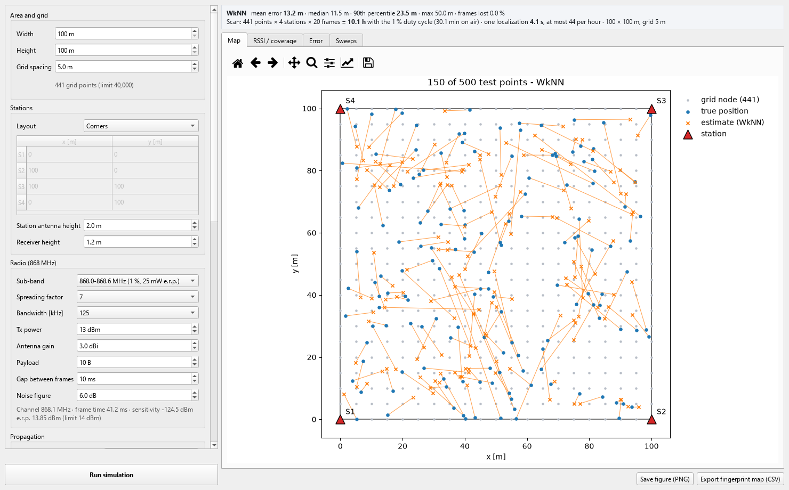
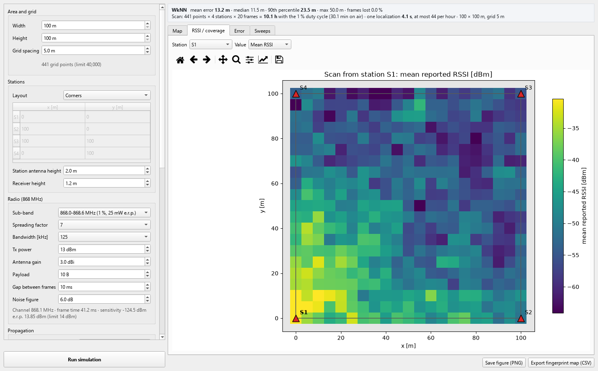
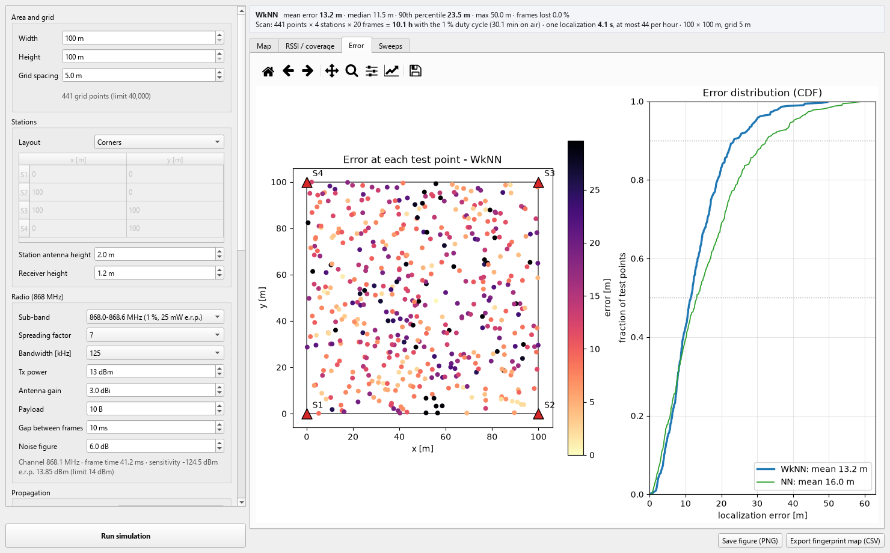
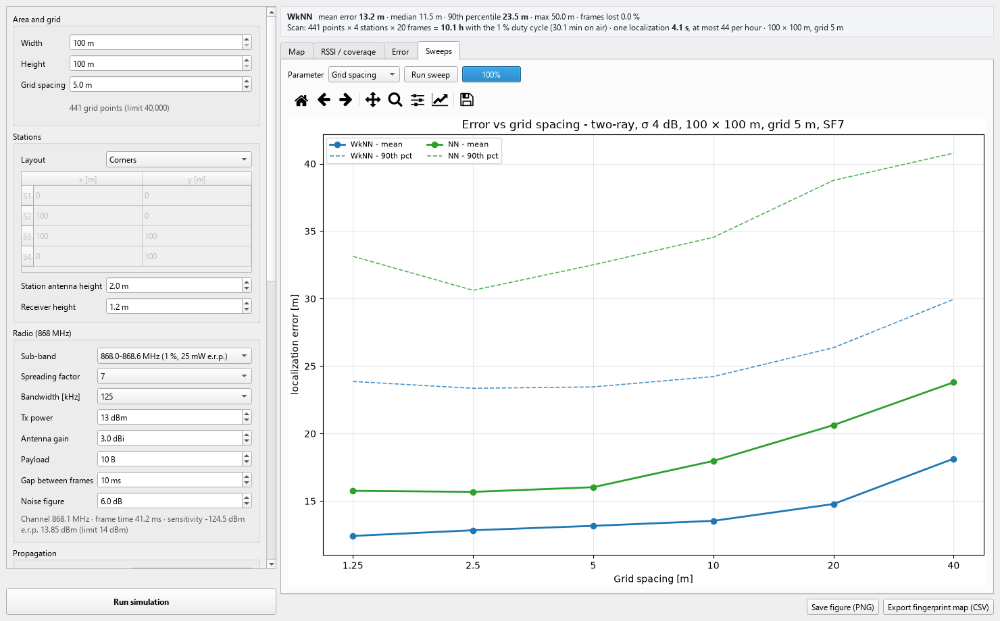
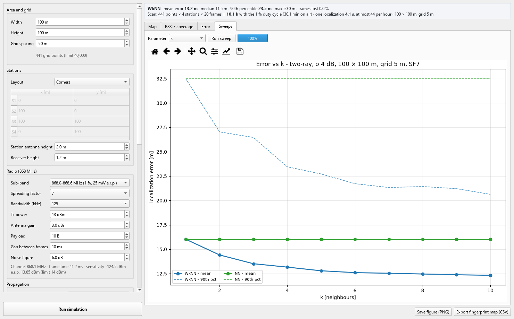

# LoRa Fingerprinting Simulator

Desktop application that simulates RSSI fingerprinting localization with LoRa (868 MHz): four fixed
base stations and one hand-held receiver. It estimates the localization error and the time needed for
the field work for a given site, radio configuration and grid.



## Simulated system

- **4 base stations** transmit short frames in turn.
- **1 receiver** averages the RSSI over N frames from each station.
- **Scan:** the receiver measures at every node of a grid over the area; the averaged values form the
  node's fingerprint.
- **Localization:** a new fingerprint measured at an unknown position is compared with the map.
  **NN** returns the most similar node, **WkNN** the weighted mean of the k most similar nodes.

## Model

Received power of one frame from station *s* at position *x*:

```
P_rx = P_tx + 2·G − PL(d) − S_s(x) − M_s(x) − N
```

| Term | Model |
|---|---|
| PL(d) | **two-ray** (default, open ground): direct wave plus the wave reflected by flat ground, from the station and receiver antenna heights and the ground type (vertical polarization, ground permittivity and conductivity from the ITU-R P.527-6 soil model: silty loam with 7 %, 30 % or 50 % water); about free space up to the breakpoint `4·h_station·h_receiver / λ` (28 m for 2 m and 1.2 m), then 40 dB per decade. **Log-distance**: `PL(d0) + 10·n·log10(d / d0)` on the 3-D distance, never below free-space loss |
| S_s(x) | shadowing: Gaussian random field with standard deviation σ and correlation `exp(−Δ / d_c)`; `S_s = √ρ·C + √(1−ρ)·I_s`, a field C shared by all stations plus the station's own field I_s, so any two stations are correlated with ρ |
| M_s(x) | multipath: Ricean channel with K-factor (Rayleigh for no line of sight). A fixed part per receiver position (independent between positions) plus a share of the multipath power that is new in every frame |
| N | frame noise: normal, independent for every frame |

**Receiver positions.** At every grid node (and at every test point) the receiver can be moved over
several positions more than half a wavelength apart, e.g. within 1 m; the frames are spread over them in
turn. Averaging over positions reduces the fixed multipath, averaging over frames only the part that
changes from frame to frame.

**Receiver**

- Noise floor `−174 dBm/Hz + 10·log10(BW) + NF`. A frame is received when its SNR is above the limit
  of the spreading factor (SF7 −7.5 dB … SF12 −20 dB).
- Reported RSSI = signal + noise in 0.5 dB steps. SNR is not used for localization: with a constant
  noise floor it carries no information beyond the RSSI.
- A fingerprint is the mean of the received frames; a station with no received frame is stored as
  −140 dBm.

**Localization:** Euclidean distance between fingerprints in dB; WkNN weights `1 / distance`.

**Timing**

- Time on air from the Semtech LoRa formula (coding rate 4/5, 8-symbol preamble, explicit header,
  CRC on, low data rate optimisation for symbols longer than 16 ms).
- Each station respects the duty cycle of the sub-band (1 % or 10 %). Scan time per grid node:
  `max(4 · N · (T_air + gap), N · T_air / duty cycle)`.

**Evaluation:** random test points over the whole area (not on grid nodes); mean, median and
90th-percentile error, frame loss, scan time, time of one localization and localizations per hour.

## Parameters

All parameters are set in the panel; every change is applied with **Run simulation**.

| Group | Parameters |
|---|---|
| Area and grid | width, height (100 m – 10 km), grid spacing (the grid always reaches all edges; limit 40 000 nodes) |
| Stations | corners, side midpoints, random or manual coordinates; station antenna height and receiver height |
| Radio | sub-band (sets the channel: LoRaWAN EU868 868.1 or 869.525 MHz, the band centre for wider channels; bandwidths wider than the sub-band are not offered), spreading factor, bandwidth, Tx power (with an e.r.p. check), antenna gain, payload, gap between frames, noise figure |
| Propagation | preset, path-loss model (two-ray or log-distance), ground type, d0, PL(d0), n, shadowing σ, correlation distance, station correlation ρ, K-factor, share of the multipath changing per frame, frame noise σ, seed |
| Frames | frames per station for the scan and for one localization, receiver positions per grid node and per localization, number of test points |
| Localization | NN or WkNN, k |

**Presets**

| Preset | For | Sources |
|---|---|---|
| Open area, line of sight (two-ray) — default | open ground without buildings, small obstacles (benches) | two-ray model; ground: ITU-R P.527-6 (30 % water: assumption); shadowing 4 dB, correlation 10 m, K 9 dB: 3GPP TR 38.901 UMi LOS (base stations at 10 m, so a starting point); station correlation 0.5: 3GPP TR 36.942 |
| Free space | reference | ITU-R P.525 |

The propagation parameters describe a particular site and should be measured there: path loss versus
distance gives d0, PL(d0), n and σ; the spatial correlation of the residuals gives the correlation
distance; repeated measurements at one position give the frame noise and the multipath spread. The
tooltips of the radio and propagation fields say where the default values come from or that they
are assumptions.

## Application

| Tab | Content |
|---|---|
| **Map** | stations, grid nodes, true and estimated positions of the test points |
| **RSSI / coverage** | scan map of mean RSSI or percentage of received frames for one station |
| **Error** | error at each test point and the error distribution (CDF) of both methods |
| **Sweeps** | mean and 90th-percentile error versus grid spacing, zone size, scan frames, localization frames, scan positions, station correlation, station height or k |

The current figure can be saved as PNG and the fingerprint map exported as CSV
(`x_m, y_m, rssi_s1..s4, frames_s1..s4`).

| | |
|---|---|
|  |  |
|  |  |

## Running

Requires Python 3.10 or newer.

**Windows:** double-click `run.bat`. The first start creates a virtual environment in
`%LOCALAPPDATA%\lora-fingerprinting-sim\venv` and installs the packages (a few minutes); later starts
open the application directly. The short path avoids the Windows path-length limit that Qt files
hit when the project sits in a deep folder.

**Any system, from a terminal opened in the project folder:**

```
pip install -r requirements.txt
python app.py
```

## Project layout

```
app.py                  desktop application (PySide6 + matplotlib)
run.bat                 sets up the environment on the first start and opens app.py (Windows)
lorasim/config.py       settings and sub-bands
lorasim/radio.py        time on air, noise floor, sensitivity, reported RSSI
lorasim/propagation.py  path loss (log-distance, two-ray), correlated shadowing, Ricean multipath
lorasim/simulation.py   scan, localization (NN, WkNN), timing, evaluation
lorasim/sweep.py        error as a function of one parameter
docs/                   screenshots
```
